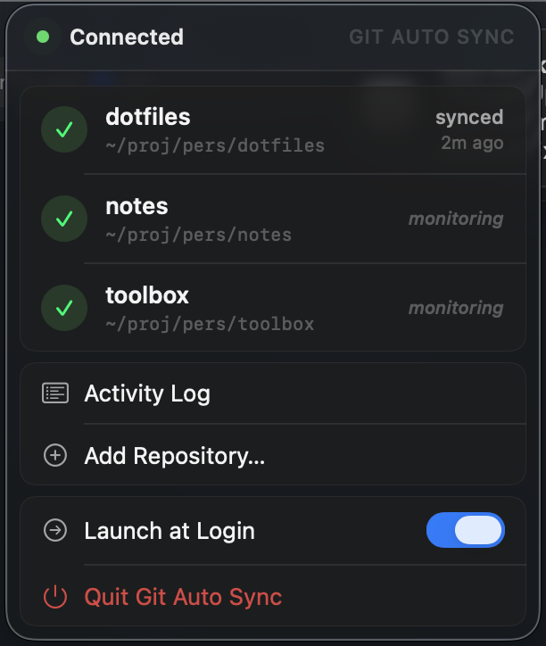

<p align="center">
  <br><br>
  <strong>git-auto-sync</strong>
</p>

# git-auto-sync

Automatically commits, rebases, and pushes your git repos in the background. You edit files, it keeps them synced. Comes with an optional macOS menu bar app.

Fork of [GitJournal/git-auto-sync](https://github.com/GitJournal/git-auto-sync) — fixed for modern macOS, uses `gh` + HTTPS, handles git locks gracefully.

## Install

Requires `just` and `go`. On macOS, also needs Xcode command line tools for the menu bar app.

```
just install-all
```

Or just the daemon: `just install`
Or just the menu bar app: `just install-app`

## Usage

### Quick test

```
git-auto-sync sync
```

Commits any changes, fetches, rebases, and pushes. If there's nothing to commit, it just syncs.

### Add a repo to the daemon

```
git-auto-sync daemon add ~/my-repo
```

That's it. The daemon starts automatically and watches the repo for file changes. It also polls every 10 minutes and syncs on wake from sleep.

You can pass any folder inside a repo: the daemon registers the repo root. If the daemon is already running, `add` and `rm` talk to it directly instead of reinstalling the service.

### Daemon commands

```
git-auto-sync daemon status            # service state plus a table of repos
git-auto-sync daemon ls                # repos being watched (name, status, branch, ahead/behind, last change, problem)
git-auto-sync daemon add [repo...]     # start watching (defaults to the current directory)
git-auto-sync daemon rm <repo...>      # stop watching; works for repos that were deleted or moved
git-auto-sync daemon sync [repo|--all] # sync now; --force retries a repo that is parked on a conflict
git-auto-sync daemon pause [repo|--all]
git-auto-sync daemon resume [repo|--all]
git-auto-sync daemon events [-n N] [-f] [repo]  # recent sync history (commit, pull, push, conflict, ...)
git-auto-sync daemon logs [-n N] [-f]  # the daemon log
git-auto-sync daemon env KEY=value     # extra environment for git (e.g. SSH_AUTH_SOCK); applies after a restart
git-auto-sync daemon restart           # restart after an update
git-auto-sync doctor                   # check the whole setup; changes nothing
```

`status`, `ls`, `events` and `doctor` accept `--json` for scripting. `sync`, `pause`, `resume` and `events` need the daemon to be running. Every command exits non-zero and prints the error on stderr when it fails. `daemon status` and `daemon ls` still work when the daemon is down: they show the configured repos instead.

### Checking your setup

```
git-auto-sync doctor
```

`doctor` only reads; it never changes anything. It checks:

- `git` is on `PATH`, and on macOS that the Xcode license has been accepted
- `gh` is installed and logged in, if any repo has a GitHub remote
- for every repo: the folder exists and is a repo, no rebase or merge is in progress, an author is configured, the branch has an upstream, and the remote answers (`git ls-remote`, 15 second timeout)
- the daemon answers on its socket and speaks the same protocol version as the CLI, and the socket is private to you
- on macOS, the LaunchAgent (`~/Library/LaunchAgents/git-auto-sync-daemon.plist`) points at a daemon binary that exists
- the log folder exists or can be created, and whether old `~/git-auto-sync-daemon.*.log` files are left over

Each line shows ✓, ⚠ or ✗, and problems come with a command that fixes them. The exit code is 1 if any check shows ✗.

## macOS menu bar app

Shows sync status for each repo, recent activity log, and native notifications when something needs your attention. Install with `just install-app`, or run directly with `just run-app`.

<p align="center">
  
</p>

The app connects to the daemon over a Unix socket. The daemon works fine without it.

## How it works

- Watches the filesystem for changes (via `fsnotify`)
- On change: stages all, commits with a summary message, fetches, rebases, pushes
- On conflict: aborts the rebase and notifies you
- Retries with backoff on transient errors (lock contention, network issues)
- 5-second cooldown after each sync to avoid re-triggering from its own git operations

### Events and notifications

The daemon keeps the last 1,000 events and remembers them across restarts, so `daemon events` and the app's timeline show history even after a reboot.

- `commit`, `pull`, `push`: something actually changed. `synced` is only recorded when one of these happened, so idle polls stay silent.
- `offline`: the remote could not be reached (no network, DNS, 5xx, timeouts). This is not an error. The daemon retries with backoff and syncs immediately on wake. No notification.
- `recovered`: a repo went back to normal after being offline or in error.
- `conflict`: a rebase hit a conflict. The rebase is aborted, your local commits are kept, and you are told once. The daemon does not retry the same conflict on every poll; it retries when either side moves or when you run `git-auto-sync daemon sync --force <repo>`.
- `error` and `preflight`: something needs your attention, such as a repo stuck mid-rebase, a branch without an upstream, or a missing git identity.

The menu bar app only notifies on transitions into a state that needs action. Without the app, the daemon falls back to a system alert for conflicts.

## Files

| What | Where |
|---|---|
| Config (repos, env) | `~/Library/Application Support/git-auto-sync/config.json` on macOS, `$XDG_CONFIG_HOME/git-auto-sync/config.json` on Linux |
| Socket, event history, repo state | `~/.local/share/git-auto-sync/` (`daemon.sock`, `events.jsonl`, `state.json`), private to your user. Set `GIT_AUTO_SYNC_SOCKET` to use another socket path |
| Daemon log | `git-auto-sync daemon logs` (`~/Library/Logs/git-auto-sync/` on macOS, `$XDG_STATE_HOME/git-auto-sync/` on Linux) |
| Per-repo settings | `git config auto-sync.syncInterval <seconds>` (30 to 86400, default 600), `git config auto-sync.batchWindow <seconds>`, `git config auto-sync.messagePrefix <text>` |

## Troubleshooting

Start with `git-auto-sync doctor`. It finds most of the problems below and prints the fix.

**`xcode_license` / exit status 69.** After an Xcode update, macOS blocks `git` until the license is accepted. Run `sudo xcodebuild -license accept`.

**`gh` not found / authentication fails only in the daemon.** The daemon runs under launchd, whose `PATH` does not include Homebrew. The daemon adds `/opt/homebrew/bin` and `/usr/local/bin` itself; if your credential helper lives elsewhere, pass it explicitly with `git-auto-sync daemon env PATH=...`. For SSH remotes, pass your agent with `git-auto-sync daemon env SSH_AUTH_SOCK=$SSH_AUTH_SOCK`.

**"Daemon is outdated".** The CLI or app is newer than the running daemon. Run `just install` and `git-auto-sync daemon restart`.

**Only one daemon runs at a time.** A second daemon that finds the socket in use waits up to 15 seconds for it to free up, then exits instead of syncing the same repos twice.

## Development

```
just build   # CLI and daemon
just check   # gofmt, vet, race tests, linux + windows cross-compile
just lint    # golangci-lint
just fuzz    # fuzz the socket protocol for 15s per target
```

### Testing against a scratch daemon

`GIT_AUTO_SYNC_SOCKET` overrides the socket path for the daemon, the CLI and the menu bar app. Combined with a temporary `HOME`, it runs a daemon that cannot touch your real config, repos or LaunchAgent:

```
export HOME=/tmp/gas-test GIT_AUTO_SYNC_SOCKET=/tmp/gas-test/d.sock
git-auto-sync-daemon &          # runs in the foreground, logs to the terminal
git-auto-sync daemon add /tmp/gas-test/some-repo
git-auto-sync daemon status
```

Keep the socket path under 104 bytes; that is the limit for Unix sockets on macOS. Do not run `daemon enable`, `disable`, `start`, `stop` or `restart` this way: they talk to launchd, which knows only one `git-auto-sync-daemon` per user. For the same reason, start the scratch daemon before `daemon add` or `daemon rm`: when no daemon answers, those two fall back to editing the config and installing or removing the launchd service.
